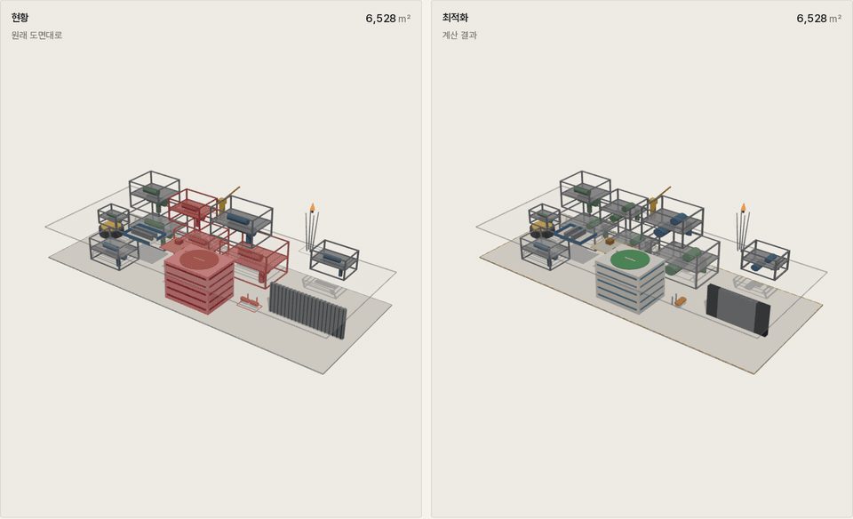
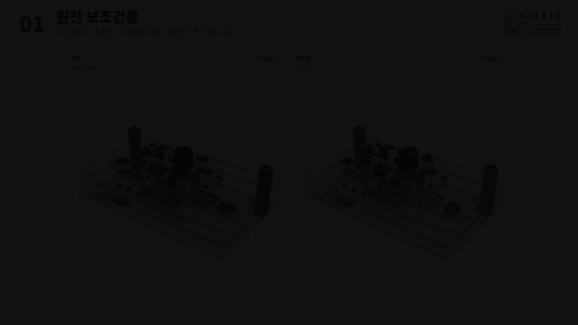
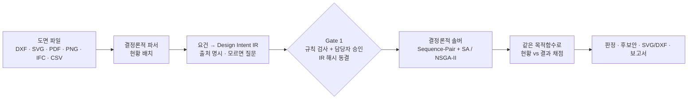

<div align="center">

<picture>
  <source media="(prefers-color-scheme: dark)" srcset="docs/readme/meic-logo-white.png">
  <source media="(prefers-color-scheme: light)" srcset="docs/readme/meic-logo-black.png">
  
</picture>

# GA Layout Optimizer

**도면을 넣으면, 각 공간의 역할을 지키면서 더 작은 배치를 찾습니다.**

건물·플랜트 배치 계획(General Arrangement)을 결정론적 솔버로 다시 짜고, 원래 도면과 같은 기준으로 비교합니다.

[](https://github.com/hajun011103/ga-layout-optimizer/actions/workflows/tests.yml)
[](LICENSE)
[](#시작하기)
[-success.svg)](#시작하기)
[](guide/CONNECT.md)
[](https://hajun011103.github.io/ga-layout-optimizer/)

[3D 결과 보기](https://hajun011103.github.io/ga-layout-optimizer/) ·
[시작하기](#시작하기) ·
[사용 방법](#사용-방법) ·
[검증](#검증) ·
[한계](#한계) ·
[인용](#인용)

<br>

[](https://hajun011103.github.io/ga-layout-optimizer/)

<sub>FPSO 해상 플랜트 상부 (가상 도면). 왼쪽 원래 배치 6,528 m² → 오른쪽 계산 결과 2,788 m², 필수 요건 위반 5 → 0.</sub>

</div>

> [!IMPORTANT]
> **개념 검토용입니다 (NOT FOR CONSTRUCTION).** 산출물은 시공·인허가·상세설계에 그대로 쓸 수 없고, 예제의 치수·이격·제약 값은 모두 가정값입니다.
> 엔진은 로컬에서만 돌지만 LLM 대화는 외부 서비스로 전송되므로, **실제 설계값을 LLM 대화에 입력하지 마십시오** ([한계](guide/LIMITATIONS.md) 18항).

<details>
<summary><b>English abstract</b></summary>

GA Layout Optimizer takes an existing drawing (DXF, SVG, vector PDF, PNG, IFC, or an equipment table), recognises the
as-is layout, and searches for a smaller layout in which every space still works: rooms stay reachable, corridors stay
connected, egress distances hold, and pipe racks and cranes still serve their equipment. Requirements are formalised as
a JSON *Design Intent IR* with cited sources, frozen after human approval, and solved by a deterministic Sequence-Pair /
simulated-annealing engine. The LLM never generates a coordinate. The as-is layout is scored with the same objective,
so the tool reports "keep as-is" or "not adoptable" instead of inventing an improvement. The engine, parsers and MCP
server use the Python standard library only and run offline. Concept-study use only.

</details>

## 결과

가상 도면 4건과 공개 실제 BIM 2건에 같은 방식으로 적용했습니다. 왼쪽은 원래 배치, 오른쪽은 계산된 배치입니다.

<div align="center">

[](https://hajun011103.github.io/ga-layout-optimizer/media/cases.mp4)

<sub>클릭하면 고화질 영상(MP4)으로 볼 수 있습니다.</sub>

</div>

| 사례 | 입력 | 원래 면적 | 계산 결과 | 변화 | 필수 요건 위반 (원래 → 결과) | 판정 |
|---|---|--:|--:|--:|:-:|---|
| 원전 보조건물 (가상, 3층) | DXF | 7,569 m² | 3,305 m² | −56.3% | 74 → **0** | 설계 검토 후보 |
| 석유화학 공정 플랜트 (가상) | 벡터 PDF | 19,764 m² | 10,396 m² | −47.4% | 16 → **0** | 설계 검토 후보 |
| FPSO 해상 플랜트 상부 (가상, 2데크) | SVG | 6,528 m² | 2,788 m² | −57.3% | 5 → **0** | 설계 검토 후보 |
| 병원 수술부 (가상) | PNG | 2,068 m² | 2,909 m² | +40.7% | 9 → **5** | 현황 유지 (요건 충돌) |
| 의료·치과 클리닉 (실제 BIM) | IFC | 3,430 m² | 3,597 m² | +4.9% | 14 → **16** | 현황 유지 |
| 연구소 건물 (실제 BIM) | IFC | 712 m² | 750 m² | +5.4% | 0 → **0** | 현황 유지 |

- 원전 보조건물은 화재 분리·해치 화재구역·터빈 미사일 등 원전 제약과 피난·출입 요건이 함께 걸려 있어, 기본 탐색량(`thorough`)으로는 위반 5건이 남아 **채택 불가**였습니다. 같은 시드에서 탐색량만 늘린 `deep`(약 1시간)으로 위반 0 배치를 찾았습니다.
- 병원 수술부는 조사한 기준(수술실이 청결 복도와 멸균 코어에 모두 접함)이 이 도면의 블록 구성으로는 동시에 성립하지 않습니다. 탐색이 아니라 설계 검토가 필요한 사항입니다.
- 실제 BIM 2건은 기능을 지키면서 더 작은 안을 찾지 못해 **현황 유지**로 판정했습니다.
- 가상 도면은 여유 공간을 일부러 담은 합성 현황이므로 **위 개선율을 성과로 인용하지 마십시오.** 현황 도면도 같은 요건을 지키지 못하는 사례가 많아(위반 수 참고) 면적 변화는 비교용입니다.

사례별 요건·가정·후보안 비교는 [guide/RESULTS.md](guide/RESULTS.md)와 [3D 결과 페이지](https://hajun011103.github.io/ga-layout-optimizer/)에 있습니다.

## 주요 기능

| | |
|---|---|
| **도면 인식** | DXF · SVG · 벡터 PDF · PNG · IFC · CSV/XLSX에서 실·기기의 위치와 크기를 결정론적 파서로 읽습니다. 인식 결과는 사람이 미리보기로 확인합니다. |
| **근거 있는 요건** | 실 출입, 동선 연결, 피난 거리, 배관대·크레인 공급, 실 규모 기준을 공개 법령·설계 지침(IBC, ADA, FGI, ASR, 10 CFR 50 등)에서 찾아 출처와 함께 넣습니다. 확인하지 못한 값은 "가정"으로 표시하고, 모르는 값은 질문으로 남깁니다. |
| **검사와 승인** | 요건(IR)을 규칙 검사(Gate 1)로 확인하고, 담당자가 승인하면 SHA-256 해시로 동결합니다. 이후 계산에는 LLM이 관여하지 않습니다. |
| **결정론적 최적화** | Sequence-Pair + 담금질(SA) / NSGA-II 솔버가 현황 배치에서 출발해 탐색합니다. 같은 IR 해시와 seed는 언제나 같은 결과 해시를 냅니다. |
| **정직한 판정** | 원래 도면을 같은 목적함수로 채점해 비교합니다. 현황이 더 나으면 "현황 유지", 필수 요건 위반이 남으면 "채택 불가"로 판정합니다. |
| **후보안 비교** | 같은 요건을 지킨 안 중 "가장 작게 · 동선 짧게 · 덜 바꾸게 · 균형" 후보를 나란히 내고, 담당자가 고릅니다. 스튜디오와 MCP 도구(`ga_optimize`의 `candidates`)에서 모두 쓸 수 있습니다. |
| **산출물** | 판정 보고서(HTML), 층별 SVG 도면, CAD용 DXF(R12), 결과 JSON. 모든 도면에 `NOT FOR CONSTRUCTION`이 찍힙니다. |

## 시작하기

Python 3.8 이상만 있으면 됩니다. 엔진·파서·MCP 서버 모두 표준 라이브러리만 쓰며, 외부 네트워크 없이 동작합니다.

```bash
git clone https://github.com/hajun011103/ga-layout-optimizer.git
cd ga-layout-optimizer
python3 tests/run_all.py                    # 테스트
python3 server/mcp_server.py --http         # → http://127.0.0.1:8765/studio
```

명령행에서 바로 돌려 볼 수도 있습니다.

```bash
python3 engine/validate_spec.py examples/spec_smr_aux.json --freeze   # 규칙 검사 + 동결
python3 engine/run.py examples/spec_smr_aux.json --iters 60000 --restarts 6
```

## 사용 방법

| 방법 | 대상 | 시작 |
|---|---|---|
| **브라우저 스튜디오** | 설치 없이 화면에서 단계별로 진행 | `python3 server/mcp_server.py --http` → `/studio` |
| **Claude Code 플러그인** | 대화로 요청하면 같은 단계를 순서대로 진행 | `/plugin marketplace add ./ga-layout-optimizer` → `/plugin install smr-ga@smr-ga-marketplace` → `/smr-ga:ga-layout` |
| **Claude Desktop · Codex CLI** | MCP 서버를 stdio로 등록 | `server/mcp_server.py` ([설정 예시](guide/CONNECT.md)) |
| **ChatGPT · Claude 웹** | 원격 MCP 커넥터로 등록 | `--http --token` + HTTPS 터널. 도면이 해당 서비스로 전달되므로 실제 설계 자료에는 쓰지 마십시오. |

자세한 연결 방법과 주의사항: [guide/CONNECT.md](guide/CONNECT.md)

## 동작 방식



LLM은 두 곳에서만 쓰입니다. 요구사항을 IR로 정리하며 빠진 값을 되묻는 단계(Gate 1 이전)와, 결과를 읽기 전용으로 설명하는 단계(마지막)입니다.
배치 좌표는 파서와 솔버만 만듭니다. 구조와 제약 라이브러리: [guide/ARCHITECTURE.md](guide/ARCHITECTURE.md)

## 검증

실제 도면에서는 "가장 작은 배치"가 무엇인지 알 수 없으므로, 최적해가 알려진 공개 문제에 같은 엔진을 돌렸습니다.
"+x%"는 알려진 최적보다 x% 비싼 해라는 뜻이며, 0%가 정답입니다.

| 벤치마크 | 문제 | 결과 (최적 대비) |
|---|---|---|
| QAPLIB (12건) | 시설 배치 표준 문제, n = 12~36 | n ≤ 19 **0.00%** · n = 20~36 **+0.16 ~ +5.37%** |
| Ejeh et al. (2019), 다층 공정 플랜트 | 요소 비료 8기기 | **+1.48%** (seed 5개 중 최선, 중앙 +6.19%) |
| | CDU 17기기 | +15.04% (중앙 +19.54%) |
| | LNG 22기기 (논문도 2.2% 갭) | +14.36% (중앙 +21.60%) |
| | COGP 25기기 (논문도 11.8% 갭) | **+39.64%** (중앙 +40.74%). 기기가 많을수록 갭이 커집니다. |
| Wrigley et al. (2019), 원전 계통 배치 | Shearon Harris 20개 모듈, 기존 14,914 | 한 면 4층 6,793. 같은 문제라고 단정할 수 없어 논문과 우열을 주장하지 않습니다. |

전체 표와 조건: [guide/BENCHMARKS.md](guide/BENCHMARKS.md)

- **재현성** 같은 IR 해시와 seed는 같은 결과 해시를 냅니다. 3D 페이지와 이 문서의 수치는 `tools/make_viewer_data.py`, `tools/make_bench_data.py`로 다시 만들 수 있습니다.
- **독립 검증** 검토 중 찾은 문제(계단 코어 정렬, 기능 요건이 기존 제약을 덮어쓰던 문제 등)를 고친 뒤의 수치만 싣습니다. 정정 이력은 [guide/RESULTS.md](guide/RESULTS.md)에 남겼습니다.

## 지원하는 도면 형식

| 형식 | 읽는 것 | 비고 |
|---|---|---|
| DXF (R12 ~ 2018) | 블록 · 해치 · MTEXT · 한글 | 기기·실 외곽, 층 |
| SVG | transform · path | |
| PDF (벡터) | OCG 레이어 · 한글 ToUnicode · xref stream | 래스터 PDF는 PNG로 변환해 사용 |
| PNG (래스터) | 벽으로 둘러싸인 실 | OCR 없음. 실 이름은 사용자가 지정 |
| IFC | IfcSpace · 기기 압출형상 · 층 | 실제 BIM 2건이 이 경로 |
| CSV · XLSX · JSON | 기기 목록 (치수·수량) | 도면 없이 IR 경로 |
| DWG · JPEG | 지원 안 함 | 변환 방법을 안내 |

## 한계

- **개념 검토용입니다.** 유료 기준(CCPS, NORSOK, FGI 최신판 등)에서 확인하지 못한 값은 요건 파일에 "가정"으로 표시했습니다.
- **복잡한 동선망을 다시 짜는 데 약합니다.** 실제 도면 2건과 원전 예제는 기능을 모두 지키면서 줄인 안을 아직 찾지 못했습니다.
- **조사한 기준 중 일부는 아직 검사하지 못합니다.** 연기 방화구획, 탈출로 2개, 방폭벽 위치, 방사선 관리구역 경계 등은 목록으로만 정리했습니다.
- **최적성 보증이 없습니다.** 메타휴리스틱이며, COGP 25기기에서 알려진 최적보다 39.6% 비쌌습니다.
- **단일 외피 패킹입니다.** 다건물 부지 배치, 실제 배관 경로 길이, 선량·차폐 계산은 다루지 않습니다.

전체 21개 항목과 실제 적용 전에 필요한 것: [guide/LIMITATIONS.md](guide/LIMITATIONS.md)

## 저장소 구조

```
engine/      파서 · IR 검증(Gate 1) · 솔버 · 도면 출력 (표준 라이브러리만)
server/      MCP 서버 (stdio · Streamable HTTP) + 브라우저 스튜디오
skills/      Claude Code 스킬과 제약 카탈로그
commands/    Claude Code 슬래시 커맨드
examples/    가상 도면 4건, 기능 요건과 조사 근거 (examples/function/)
tests/       단위·재현성·벤치마크 테스트, 공개 벤치마크 데이터
tools/       예제·3D 페이지 데이터 생성 스크립트
docs/        3D 결과 페이지 (GitHub Pages)
guide/       아키텍처 · 결과 · 벤치마크 · 한계 · 연결 문서
```

## 문서

| 문서 | 내용 |
|---|---|
| [guide/ARCHITECTURE.md](guide/ARCHITECTURE.md) | 파이프라인, 도면 경로, MCP 도구 18개, 제약 라이브러리, 목적함수, 알고리즘, 재현성 |
| [guide/RESULTS.md](guide/RESULTS.md) | 사례 6건 상세, 이전 실행과의 비교, 정정 이력 |
| [guide/BENCHMARKS.md](guide/BENCHMARKS.md) | QAPLIB · Ejeh 2019 · Wrigley 2019 전체 표와 조건 |
| [guide/LIMITATIONS.md](guide/LIMITATIONS.md) | 한계 21항, 실제 적용 전에 필요한 것 |
| [guide/CONNECT.md](guide/CONNECT.md) | Claude Code · Claude Desktop · Codex · 웹 커넥터 · 스튜디오 · CLI |
| [examples/function/README.md](examples/function/README.md) | 기능 유지 요건 6종과 근거 출처 |
| [AGENTS.md](AGENTS.md) | 에이전트 공통 규약 |

## 인용

이 저장소를 연구에 사용하셨다면 아래와 같이 인용해 주십시오. GitHub 저장소 페이지의 **Cite this repository** 버튼으로 BibTeX를 받을 수도 있습니다 ([CITATION.cff](CITATION.cff)).

```bibtex
@software{meic_ga_layout_optimizer_2026,
  author  = {{MEIC Lab}},
  title   = {{GA Layout Optimizer}: Function-preserving layout optimization from existing drawings},
  year    = {2026},
  version = {0.3.0},
  url     = {https://github.com/hajun011103/ga-layout-optimizer},
  license = {Apache-2.0}
}
```

## 데이터 출처와 라이선스

| 데이터 | 출처 | 라이선스 |
|---|---|---|
| Medical-Dental Clinic IFC | BSI (2020) "Medical-Dental Test Files," buildingSMART International, [Community-Sample-Test-Files](https://github.com/buildingsmart-community/Community-Sample-Test-Files) | CC BY 4.0 (저장소 미포함) |
| 연구소 건물 IFC | Karlsruhe Institute of Technology, `AC20-Institute-Var-2.ifc`, [steptools 공개 샘플](https://downloads.steptools.com/docs/stpfiles/ifc/) | 공개 샘플 모델 (저장소 미포함) |
| Shearon Harris 배치 데이터 | Wrigley, University of Derby (2018), `data.mendeley.com/datasets/w39zbzj6bk/1`; Wrigley et al. (2019) *Nucl. Eng. Des.* 341 | CC BY 4.0 (`tests/data/wrigley2019/`) |
| QAPLIB 12건 | Burkard, Karisch, Rendl (1997) *J. Global Optim.* 10 | 공개 배포본 (`tests/data/qaplib/`) |
| Ejeh 2019 부록 B | Ejeh, Liu, Papageorgiou (2019) *Comput. Chem. Eng.* 131, 106573, [저자 원고](https://discovery.ucl.ac.uk/10096679/1/CACE_JOE_SL_LGP_accepted.pdf) | 논문 데이터 전사 (`tests/data/ejeh2019/`) |
| 가상 도면 4건 | `python3 tools/make_examples.py`로 생성한 합성 도면 | Apache-2.0 |

실제 BIM 2건은 IfcSpace를 직사각형 블록으로 근사해 사용했으며 원본 파일은 수정하지 않았습니다.

## 개발

<picture>
  <source media="(prefers-color-scheme: dark)" srcset="docs/readme/meic-logo-white.png">
  <source media="(prefers-color-scheme: light)" srcset="docs/readme/meic-logo-black.png">
  
</picture>

**MEIC Lab** (Mechanical Systems with Intelligence and Computer Vision)에서 수행한 연구입니다.
문의와 버그 제보는 [Issues](https://github.com/hajun011103/ga-layout-optimizer/issues)로 남겨 주십시오.

## 라이선스

[Apache License 2.0](LICENSE). 벤치마크·실제 도면 데이터는 각 출처의 라이선스를 따릅니다.
